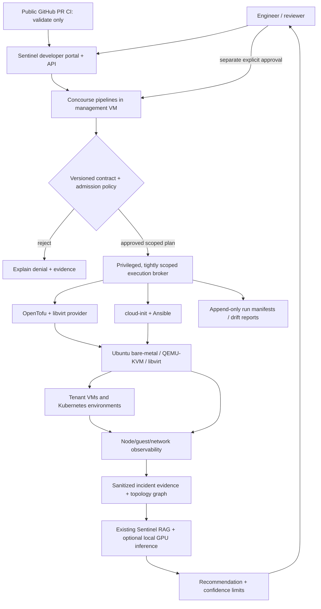

# RFC 0003 — Sentinel Fabric: governed private cloud + AI-assisted operations

**Status:** PROPOSED / DESIGN ONLY, 2026-11-03  
**Target:** Dell PowerEdge R740 bare-metal host and existing Sentinel AI GitHub repository  
**Scope:** Public reference architecture and implementation roadmap. **No live deployment or migration is authorized by this RFC.**

## 1. Product proposition

**Sentinel Fabric** is a small-footprint, enterprise-pattern *private-cloud control plane* that turns a hardware server into an auditable, self-service platform. A developer declares a virtual machine or environment; the system validates ownership, capacity, image provenance and network policy; a trusted runner creates and configures the VM; evidence is captured continuously; and Sentinel AI can investigate deliberately generated faults **without independent mutation privileges**.

The unique portfolio demonstration is **not VM count**. It is a defensible lifecycle: request -> policy decision -> immutable reviewed plan -> approval -> provision -> verify -> observe -> fault experiment -> incident evidence -> AI-assisted diagnosis -> human-approved repair -> expiry/decommission.

Research comparison: JPMorgan Chase publicly describes an integrated self-service engineer platform, multiple virtualization estates (Hyper-V/VMware VCF and OpenShift Virtualization), IaC, BOSH/Concourse, Jenkins, and a custom workload-management system in separately described teams. Public job ads do **not** reveal one internal universal stack. Sources and evidence confidence are documented in [JPMC platform-engineering evidence](../research/jpmc-platform-engineering-2026.md).

## 2. Baseline and hard limits

Operator-reported physical baseline as of 2026-11-03 (not a live probe by this document):

- `sentinel-baremetal-01`: Ubuntu 26.04.1 LTS, 2 x Xeon Silver 4210 = 20 physical cores/40 threads; 64 GB ECC RAM (~61 GiB usable).
- `/dev/kvm` available, QEMU/libvirt/virtinst installed and verified; SSH operational. No bare-metal VMs reported created yet.
- Dell PERC H740P Mini hardware RAID; 2 x 240 GB SATA SSDs mirrored as `sentinel-os`; root filesystem ~218 GiB with ~195 GiB free. Third SSD not confirmed present. **Storage capacity is the first material constraint.**
- Broadcom quad-port 1 GbE; `eno1` currently carries the management LAN address `192.168.0.114/24` with gateway `192.168.0.1`; other ports down. Dedicated iDRAC9 Enterprise reachable and separate from guest administration.
- Windows 11/Hyper-V existing lab and its VMs remain completely out of scope. Previous Stage 5 fresh-cluster success was operator-reported with in-run fixes, not proven repeatable clean bootstrap.

Never assume hardware capacity from seller's three-drive basket; explicitly reconcile disk inventory before storage expansion. Never alter PERC volumes or the active `eno1` network bridge as an incidental provisioning step. iDRAC credentials and secrets remain outside Git.

**Availability claim:** A single physical host is one failure domain; guests on it cannot provide genuine hardware-level high availability, regardless of control-plane replica count. Real failover/VM migration would require additional physical hosts and supporting storage/network topology.

## 3. Target logical architecture



### Deployment locations

- **Bare-metal Ubuntu host (source of truth for virtual compute):** libvirt/KVM, host monitoring, isolated libvirt networks/storage pools, narrowly authorized execution broker. Keep it stable and minimal.
- **Management VM, hosted on bare-metal:** Concourse web/worker/PostgreSQL (dev-sized), request API, policy engine, artifact registry/cache, scheduler, audit service. Runs independently of the Windows laptop, but not of the physical server.
- **Observation VM:** Prometheus/Grafana/Alertmanager and bounded log collection. Data retention and cardinality limits are mandatory.
- **Application Kubernetes VMs:** one control plane and two workers, deployed by the platform; demonstrate placement, topology and controlled incident recovery without mislabeling virtual nodes as independent hosts.
- **Disposable tenant VM:** non-Kubernetes service catalog scenario (e.g. a payments simulation), custom TTL and isolation policy.
- **Windows workstation:** source-code development, optional GPU Ollama + Sentinel diagnostic API. The core fabric must work even when the laptop/AI endpoint is off, with read-only diagnosis reporting unavailable; it must not be the sole scheduler.

### Integration boundaries

The public GitHub checkout has no live host credentials. Public PR jobs run tests, schemas, lint and dry plans against synthetic fixtures **only**. A protected private environment-config repo holds desired profiles, names, network policies, image references and **secret references**, not secret values. A private secret manager or equivalent local vault holds secrets. Saved IaC plans/state, generated cloud-init seed files, private inventories and raw reports stay on a restricted host-managed store; never attach them to public workflow artifacts. A private Concourse runner has no arbitrary root/libvirt socket or unchecked shell access. Use an allowlisted broker/API to validate the approved plan + environment + resource identities.

## 4. Tool decisions and tradeoffs

| Capability | Initial choice | Why / limits |
| --- | --- | --- |
| Virtualization | **Ubuntu + QEMU/KVM + libvirt** | Already verified; automation API; no reimage; `cockpit-machines` optional operator UI |
| Declarative VM inventory | **OpenTofu** + version-pinned `dmacvicar/libvirt` provider | Provider supports domains, pools, networks and remote libvirt URI; test its 0.9.x schema on disposable fixtures before adoption |
| Golden images | **Packer QEMU** + signed/pinned upstream cloud image + cloud-init | Build, test, hash and approve image revisions; do not auto-follow `latest` |
| Guest baseline | **Ansible** (reuse existing roles where compatible) | Idempotent patching, hardening, packages, certificates; introduce Linux/KVM identity adapter |
| Pipeline orchestrator | **Concourse** | Aligns with platform role research and existing operator experience; plan/apply separated by explicit approval |
| Admission / governance | **OPA or equivalent deterministic policy service** | Deny oversized, unauthorised, public-network or destructive requests |
| Service catalog and UI | Existing **FastAPI**, then lightweight React portal | Showcase value without the RAM/complexity of a large portal framework initially |
| Telemetry | OpenTelemetry collectors + Prometheus/Grafana, logs | Correlate hypervisor/guest/VM/app and SLO signals with run identity |
| Troubleshooting | Existing Sentinel RAG; Ollama stays external on Windows GPU initially | AI proposes checks from sanitized trusted evidence; cannot access raw hypervisor credentials |
| Identity | Approver identity + operator identity; SSH host-key verification | Reuse existing strict trust approach conceptually, implement a libvirt-specific verifier; QEMU Guest Agent is **not cryptographic attestation** |

**Alternative reviewed but not chosen:** Proxmox VE provides an excellent web UI and API, with the bpg provider for OpenTofu. It is typically installed as a Debian-based virtualization host, **not an Ubuntu package added to the existing live system**. Switching now means a separately planned backup and destructive reinstallation; PERC hardware RAID means do not place ZFS directly over the RAID logical disk. vSphere/VCF is enterprise-relevant but an inappropriate license/hardware dependency for the first implementation. OpenShift Virtualization is valuable for a later separate research environment, but does not make this single physical host highly available. BOSH is a lifecycle orchestrator for distributed software, not the simplest first VM portal; a future BOSH/Concourse adapter can demonstrate cloud-provider abstraction.

## 5. Proposed capacity envelope (non-binding, preflight must confirm)

| VM | Role | vCPU | RAM | virtual disk |
| --- | --- | ---: | ---: | ---: |
| `fabric-mgmt-01` | Concourse, policy, API, audit | 2 | 8 GiB | 24 GiB |
| `fabric-obs-01` | Metrics, logs, alerts | 2 | 6 GiB | 24 GiB |
| `fabric-kcp-01` | Kubernetes control plane | 2 | 4 GiB | 18 GiB |
| `fabric-kw01` | Worker, payments simulation | 3 | 6 GiB | 24 GiB |
| `fabric-kw02` | Worker, synthetic failures | 3 | 6 GiB | 24 GiB |
| `fabric-tenant-01` | Ephemeral VM lifecycle demo | 2 | 4 GiB | 16 GiB |
| **Total** | Proposed peak | **14 vCPU** | **34 GiB** | **130 GiB** |

This is **not** a first-deploy target. Start with a single disposable 1–2 GiB VM and then management plane. Reserve >= 12 GiB RAM for host and adequate additional headroom; leave >= 40 GiB actual free disk at all times under a preflight gate. Thin virtual disks do not remove physical capacity risk. Observability retention, CI image caches, snapshots and disk I/O make the present 218 GiB root volume unsuitable for substantial scale; expand dedicated VM storage only through a separate storage review, backups and disk inventory.

## 6. Multi-tenant request contract (illustrative only)

```yaml
apiVersion: fabric.sentinel.dev/v1alpha1
kind: VirtualMachineRequest
metadata:
  name: payments-sandbox-01
  owner: payments-demo
spec:
  profile: small
  imageRef: approved-ubuntu-2604-v1
  networkRef: isolated-tenant-dev
  expiresAfterHours: 24
  deletionProtection: true
  environment: disposable
```

The contract **cannot** set arbitrary host paths, scripts, command arrays, bridge devices, MACs, image URLs or hypervisor identifiers. Resolve a reviewed image catalog entry to its immutable bytes and independently reviewed checksum. Resolve network IDs from a preapproved catalog. Do not copy the raw submitted YAML into a shell. The contract carries no secrets.

### Guarded lifecycle and evidence

1. Request accepted with authenticated identity, tenant, idempotency key and schema version.
2. Normalize catalog/profiles; verify image origin, signature/digest and host path ownership.
3. Collect fresh actual memory, storage, virtualization, MAC, IP and virtual-network allocations; reject collisions and capacity overcommit against quota.
4. Generate deterministic IaC plan. Run schema/policy/security tests and show planned changes, sensitive values redacted.
5. Bind approval to immutable code/config/image revisions, exact plan digest, requesting identity, scope, expiry and target host.
6. Only a restricted broker starts the approved action; do not run arbitrary Concourse pipeline scripts with the host libvirt socket mounted.
7. Verify VM UUID, NIC/MAC, disk identity, first-boot completion, host-key binding and actual SSH before Ansible and tests. A guest-agent or console-reported key is **evidence**, not tamper-resistant attestation.
8. Publish non-secret run manifest: request, plan hash, policy versions, approvals, timestamps, provider version, inventory IDs, results and drift status.
9. Reconciliation detects drift and opens a reviewable proposal; it does not silently delete, replace or re-IP a workload.
10. Dispose only of an explicitly owned disposable VM with matching creation identity and reviewed expiry/approval policy. Failure leaves state preserved for diagnosis unless a precisely scoped cleanup rule has been separately proved.

Expected states: `REQUESTED -> VALIDATED -> PLANNED -> APPROVAL_REQUIRED -> PROVISIONING -> VERIFYING -> READY -> DRIFTED/DEGRADED -> DECOMMISSION_REQUESTED -> DESTROYED`, plus explicit `REJECTED`, `FAILED_PRESERVED`, `QUARANTINED`. Every transition produces an audit event.

## 7. Network and resilience architecture

Start with **private libvirt NAT / isolated networks**, not public L2 bridge changes:

- `fabric-control`: management service endpoints, locked behind authenticated SSH/tunnel, egress scoped.
- `fabric-tenants`: guest traffic, DNS/DHCP assignments, explicit routes and isolation rules.
- `fabric-experiment`: deliberately impaired test workloads/fault injector, isolated from host management and LAN.
- iDRAC remains a hardware recovery path in its existing dedicated management connection; never expose it publicly.

Choose private subnets only after read-only route/IP/overlap checks against the host, Windows Hyper-V lab, VPN and home router. Verify egress and ingress rules with both positive and negative tests. Avoid changing `eno1` or its default route from an SSH-only session. Extra NICs and VLAN trunks are an advanced step requiring physical switch support and a separately approved network change.

**Do not claim:** cross-physical-host HA, shared-storage live migration, production DR, zero-downtime host failure or secure remote internet access without tested supporting infrastructure.

## 8. Sentinel's differentiator: evidence-linked incident digital twin

Maintain a small typed dependency graph derived from **declarative inventory and observed state**, not from model-generated assertions:

Physical host -> libvirt domain -> vNIC -> virtual network -> VM guest -> Kubernetes node -> workload -> Service -> synthetic user request.

Each node has provenance, revision, timestamps, confidence/source type and tenant scope. Correlate guest, hypervisor, pipeline, deployment, and app metrics by immutable run ID and resource identity.

**Example failure:** a deliberate tenant network impairment causes `payments-api` HTTP 503.

- Native monitoring detects error-rate / SLO burn.
- Correlation distinguishes changed network rule, VM health, pod readiness, endpoints and CI change timeline.
- Rule-based detector creates a factual incident bundle with observation timestamps and runbook references.
- Sentinel AI retrieves cited runbooks and produces ranked, explicitly uncertain hypotheses + *read-only* checks.
- The portal displays a bounded remediation proposal with preconditions and blast radius.
- Human approval authorizes one allowlisted action; verification compares service-level metrics and records rollback outcome.
- Compare **no-AI / observability-only / AI-read-only / human-gated remediation** arms with the separately proposed research protocol. Never attribute Kubernetes' native restart recovery to the AI.

### Measures

Provision request-to-ready p50/p95, success ratio, idempotence/drift violations, build image reproducibility; **policy-negative-case rejection rate**, unauthorized-mutation count, evidence completeness; service request error rate, latency, SLO burn, detection delay, diagnostic correctness judged against ground truth, recovery execution time, operator approval wait time and end-to-end MTTR. Each metric needs a measurement definition, a baseline, and trial counts. No fabricated performance claims.

## 9. Public-demo acceptance path

1. Open the portal; select **Create environment: payments-staging**. Show plan, expected RAM/disk, source image, owner, resource expiry and network.
2. Submit; show blocked self-approval/out-of-scope network or oversized request as separate negative controls.
3. Approve the legitimate plan; Concourse provisions a VM from reviewed image, verifies host key, configures via Ansible and publishes smoke-test evidence.
4. Demonstrate topology graph from physical R740 through domain/network/guest to Kubernetes and service; display run IDs.
5. Inject an approved, reversible failure **only** into an isolated synthetic tenant environment; observe errors, detection and correlated timeline.
6. Show Sentinel AI's source-linked incident analysis and clear human-review boundary.
7. Approve deterministic allowlisted remediation, verify SLO restoration and display before/after metrics.
8. Request safe decommission, show exact deletion target/ownership/plan, deny deletion of protected VM and publish final audit manifest.

Demo can use recorded, reviewed **real** execution evidence if live host is offline. Never imply recorded playback is live.

## 10. Implementable delivery plan and proof gates

**Phase 0 — Inventory + decision record (read-only):** verify firmware, RAM, storage topology, backups, actual free disk and private network collision; validate QEMU/libvirt versions, user access model, iDRAC recovery plan. Output immutable inventory and threat model. **Gate:** no mutations.

**Phase 1 — One golden disposable VM:** pinned cloud image; one private network; OpenTofu libvirt provider version pinned; cloud-init + host identity check + Ansible. Prove repeatability, state retention, safe refusal on collision, failure preserved and accurate timing. **Gate:** no VM auto-deletes.

**Phase 2 — Trusted management plane:** management VM with Concourse, restricted broker and approval binding; public CI remains validate-only; separate environment config and secret handling; signed/auditable run reports. **Gate:** unauthorized pipeline cannot request host mutations.

**Phase 3 — Self-service cloud:** catalog/API/portal; quotas, IPAM/DHCP tracking, ownership, expiry, approval history, drift and lifecycle state machine. **Gate:** adversarial policy tests, idempotence and interrupted-run continuation plan.

**Phase 4 — Service platform:** deploy Kubernetes through catalog/Ansible and existing validated playbooks adapted to KVM-specific trust, network and CIDR. **Gate:** clean rebuild on disposable resources, guest/Pod cross-node DNS/traffic tests, no interference with Hyper-V.

**Phase 5 — Telemetry and fault laboratory:** host/guest/app metrics and links, workload error budget, workload fault injection, bounded logs and research trial harness. **Gate:** per-scenario isolation and post-cleanup state proof.

**Phase 6 — Governed AI operations + showcase:** integrate existing RAG with factual incident graph, negative controls, human-approved safe actions, replayable evidence, benchmark report and polished public architecture/video. **Gate:** ground-truth comparison and clear failure limitations.

### GitHub outputs and engineering review

- `docs/research/jpmc-platform-engineering-2026.md`: evidence matrix, dated sources, public disclosure boundaries.
- This RFC and ADRs for hypervisor selection, identity/trust, approval protocol, environment-state isolation, resilience, secrets, storage and network.
- `infrastructure/fabric/`: provider-pinned modules, image templates, private catalog schemas, test fixtures, Concourse jobs, Ansible compatibility layer and policy negative tests; **implementation does not exist yet**.
- `api/` + new portal UI: VM lifecycle API, topology/evidence endpoint, agent integration under authorization.
- `evaluations/fabric/`: reproducible experiments, synthetic failures, baseline metrics, redacted execution data and honest results.
- README: architecture diagram, 90-second narrated demo, proof links, test matrix, source map and explicit single-host limitations **after** code works.

## 11. First implementation PR after this RFC

Implement **read-only `fabric doctor` + `fabric plan` on synthetic config** before creating any VM:

- discover hardware, libvirt, pools, network routes, disks, available memory, and reserved VM identities;
- validate an API schema with test fixtures, profile limits, host reserves, image catalog and path ownership;
- render a plan that explicitly displays `CREATE/CHANGE/DELETE` and refuses unauthorized existing resources;
- include tests for duplicate IP/MAC, missing image hash, unacceptable subnet, disk reserve, host-only management NIC changes, path traversal, untrusted provisioner, mixed owner, and wrong approval digest;
- make **zero changes** to the server in PLAN mode.

Next, approved code review and operator-driven provisioning of *one* disposable VM on `sentinel-baremetal-01`. Maintain existing Windows lab as regression baseline.

## References

- [JPMorgan Chase — Engineer's Platform & Experience](https://www.jpmorganchase.com/about/technology/blog/our-commitment-to-the-engineer-experience)
- [JPMorgan Chase — Hyper-V and VMware senior lead role, 2026-10-01](https://jpmc.fa.oraclecloud.com/hcmUI/CandidateExperience/en/sites/CX_1002/job/210794576)
- [JPMorgan Chase — Hyper-V workload-management .NET role, 2026-10-02](https://jpmc.fa.oraclecloud.com/hcmUI/CandidateExperience/en/sites/CX_1001/job/210793646)
- [JPMorgan Chase — OpenShift Virtualization role, 2026-09-04](https://jpmc.fa.oraclecloud.com/hcmUI/CandidateExperience/en/sites/CX_1002/job/210783555)
- [JPMorgan Chase — Cloud Foundry / BOSH / Concourse role, 2026-10-22](https://jpmc.fa.oraclecloud.com/hcmUI/CandidateExperience/en/sites/CX_1001/job/210800125)
- [JPMorgan Chase — Linux, VMware, IaC, CI/CD role, 2026-08-26](https://jpmc.fa.oraclecloud.com/hcmUI/CandidateExperience/en/sites/CX_1001/job/210781140)
- [Concourse architecture](https://concourse-ci.org/docs/install/), [Cockpit machines](https://cockpit-project.org/guide/195/feature-virtualmachines.html), [Packer QEMU](https://developer.hashicorp.com/packer/integrations/hashicorp/qemu), [libvirt Terraform provider](https://github.com/dmacvicar/terraform-provider-libvirt)
- [Terraform plan and secret handling](https://developer.hashicorp.com/terraform/tutorials/automation/automate-terraform); [OpenShift Virtualization HA and live migration constraints](https://docs.redhat.com/en/documentation/openshift_container_platform/4.20/html/installing_on_bare_metal/preparing-to-install-on-bare-metal)
